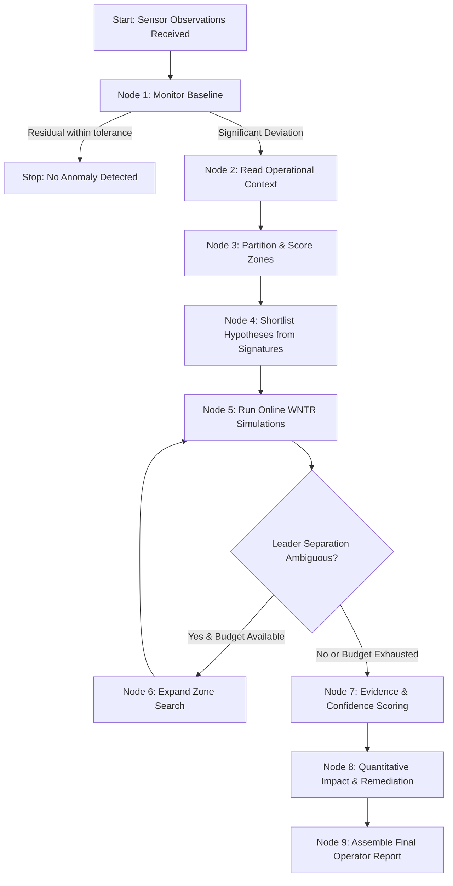

# WaterGuard 💧
### Physics-Grounded Hydraulic Diagnostic Agent & Water Network Intelligence

WaterGuard is an intelligent water distribution monitoring, fault diagnosis, and quantitative resource analysis platform. It combines physical hydraulic simulation (**WNTR / EPANET**) with agentic diagnostic reasoning (**LangGraph**) to detect anomalies, isolate pipe leaks, identify valve restrictions, and evaluate consumption surges from sensor observations without brute-force guesswork.

---

## Table of Contents

- [Overview & Architecture](#overview--architecture)
- [Key Features](#key-features)
- [How It Works: Agentic Investigation Workflow](#how-it-works-agentic-investigation-workflow)
- [Understanding Dashboard Visualizations & Graphs](#understanding-dashboard-visualizations--graphs)
- [Step-by-Step Setup Guide (Fresh System)](#step-by-step-setup-guide-fresh-system)
  - [Prerequisites](#prerequisites)
  - [macOS / Linux Installation](#macos--linux-installation)
  - [Windows Installation](#windows-installation)
  - [One-Click Start (macOS)](#one-click-start-macos)
- [Running Tests & Verifications](#running-tests--verifications)
- [Household Network Onboarding](#household-network-onboarding)
- [API Endpoints](#api-endpoints)
- [Project Directory Structure](#project-directory-structure)
- [Configuration & Environment](#configuration--environment)
- [License](#license)

---

## Overview & Architecture

Modern water networks operate with sparse sensor deployments. When anomalous pressure drops or flow deviations appear, operators face combinatorial ambiguity: *Is a pressure drop caused by a burst main, an unrecorded construction draw, or an inadvertently throttled valve?*

WaterGuard solves this by uniting two complementary engines:
1. **Hydraulic Simulation Engine (WNTR / EPANET):** Solves exact mass conservation and energy equations across complex looped pipe networks to compute deterministic pressure head and flow distributions.
2. **Adaptive Diagnostic Agent (LangGraph):** Orchestrates a bounded, non-hallucinatory reasoning workflow. It compares live or manual measurements against a healthy baseline, queries pre-calculated sensitivity signatures across partitioned topological zones, shortlists high-likelihood candidates, and tests them in fresh, isolated WNTR simulations.

```
       ┌────────────────────────┐
       │ Sensor Observations    │ (Pressures in m, Flows in L/s)
       └───────────┬────────────┘
                   │
                   ▼
       ┌────────────────────────┐
       │ Healthy Baseline Model │ ◄── WNTR Snapshot Physics
       └───────────┬────────────┘
                   │
                   ▼
       ┌────────────────────────┐
       │ Topological Fingerprint│ ◄── Catalog of Precomputed Signatures
       │ Coarse Zone Scoring    │     (Pipe Leaks, Restrictions, Surges)
       └───────────┬────────────┘
                   │
                   ▼
       ┌────────────────────────┐
       │ Adaptive WNTR Sim Runs │ ◄── Fresh Dynamic Hydraulic Verifications
       └───────────┬────────────┘     (Strict Simulation Budget)
                   │
                   ▼
       ┌────────────────────────┐
       │ Uncertainty & Ranking  │ ──► Quantitative Impact & Remediation Benefit
       └───────────┬────────────┘
                   │
                   ▼
       ┌────────────────────────┐
       │ Operator Action Report │ (Clear guidance, Next Sensor Recommendation)
       └────────────────────────┘
```

---

## Key Features

- ⚡ **Autonomous Agentic Reasoning (LangGraph):** Bounded 6-stage state graph with topological zone search, adaptive candidate shortlisting, and live Server-Sent Events (SSE) telemetry.
- 🌊 **Physics-Grounded Verification:** Every hypothesis must be verified by a clean, independent WNTR run before presentation. Zero speculative hallucinations.
- 📈 **Dual Real-Time Baseline Line Graphs:** Side-by-side, high-contrast profiles for junction pressures (healthy blue vs. observed red) and pipe flows (healthy emerald vs. observed orange).
- 💧 **Quantitative Physics Impact Analysis:** Real calculations of water escape (flow in L/s, m³/day), distribution throttling percentage, affected junction disruptions, and repair efficiency gains.
- 🗺️ **Interactive Network Map:** Interactive SVG diagram with connected zone partitions, node selection, pan/zoom controls, and highlighted fault leader candidates.
- 📐 **Guided Network Onboarding:** Upload plumbing diagrams (PDF/PNG), draw networks on a visual canvas, or answer structured guided questions to generate valid EPANET `.inp` models.
- 🔬 **Custom Fault Injection:** Simulate hypothetical pipe ruptures, line restrictions, and surges safely with adjustable severity from 0.05 to 1.00.

---

## How It Works: Agentic Investigation Workflow



1. **Baseline Check (`monitor`):** Compares observed sensor measurements against the healthy zero-hour model snapshot.
2. **Context Enrichment (`context`):** Incorporates local maintenance logs, weather data, or operating schedule notes.
3. **Coarse Zone Ranking (`rank_zones`):** Network topology is partitioned into connected zones. Catalog signatures rank which zones best explain the observed pattern.
4. **Candidate Shortlisting (`hypotheses`):** Extracts top candidate combinations of fault type, location, and severity.
5. **Simulation Verification (`simulate`):** Executes fresh, isolated WNTR hydraulic runs within a strict scenario budget (default 8 runs).
6. **Adaptive Expansion (`expand`):** If top candidates remain ambiguous, expands the search to adjacent zones.
7. **Evidence & Diagnosis (`evidence`, `diagnose`):** Evaluates sensor-by-sensor fit, flags ambiguity when competing explanations overlap, and formats practical operator advice.
8. **Quantitative Analysis (`impact`):** Calculates physical discharge volume, distribution impedance, and project recovery metrics.

---

## Understanding Dashboard Visualizations & Graphs

### 1. Dual Baseline Comparison Profiles
- **Junction Pressure Profile:**
  - **Healthy Baseline Line (Blue `#1d4ed8`):** Nominal water head (metres) expected across all junctions in steady state.
  - **Observed Alert Line (Rose `#e11d48`):** Current observed measurements with changed readings highlighted.
  - **Pressure Change Delta:** Signed deviation stem plot showing pressure drops or increases at each junction.
- **Pipe Flow Profile:**
  - **Healthy Baseline Line (Emerald `#059669`):** Nominal flow rate (L/s) across all network pipes.
  - **Observed Alert Line (Orange `#ea580c`):** Measured flow rate; negative values indicate flow reversal.
  - **Flow Change Delta:** Signed deviation stems indicating flow acceleration or throttling.

### 2. Quantitative Fault & Resource Analysis
- **Water Loss / Escape (or Conveyance Throttled):** Physical escape volume or line capacity choked (in L/s and m³/day).
- **Resource Disruption Percentage:** Proportion of consumption junctions suffering pressure deficit or low head below safe thresholds.
- **Projected Repair Benefit:** Delivery capacity restored and percentage of hydraulic delivery efficiency recovered upon repair.

---

## Step-by-Step Setup Guide (Fresh System)

Follow these instructions to set up and run WaterGuard on a completely new machine.

### Prerequisites

| Component | Required Version | Description |
|---|---|---|
| **Python** | `3.11` or higher | Core runtime (`python3 --version`) |
| **Git** | Any modern version | Clone and manage the codebase |
| **Poppler** *(Optional)* | Any modern version | Enables PDF page counting and text extraction for diagram onboarding (`brew install poppler` on Mac, `apt-get install poppler-utils` on Ubuntu) |

---

### macOS / Linux Installation

#### 1. Clone the repository
```bash
git clone https://github.com/DEVANSHkewlani/WaterGuard.git
cd WaterGuard
```

#### 2. Create and activate a virtual environment
```bash
python3 -m venv .venv
source .venv/bin/activate
```

#### 3. Upgrade pip and install dependencies
```bash
pip install --upgrade pip
pip install -r requirements.txt
```

*(Optional) Install developer dependencies if you plan to run automated tests:*
```bash
pip install -r requirements-dev.txt
```

#### 4. Prepare precomputed signatures (Net1 catalog)
Run this one-line command to build fault signatures if they are not already cached:
```bash
python -c "from backend.fingerprints import load_catalog, build_catalog; (lambda: load_catalog('Net1'))() if False else build_catalog('Net1')"
```

#### 5. Start the WaterGuard server
```bash
python -m uvicorn backend.main:app --host 127.0.0.1 --port 8000
```

#### 6. Open the Dashboard
Visit **[http://127.0.0.1:8000/](http://127.0.0.1:8000/)** in your web browser.

---

### Windows Installation

#### 1. Clone the repository
Open PowerShell or Command Prompt:
```powershell
git clone https://github.com/DEVANSHkewlani/WaterGuard.git
cd WaterGuard
```

#### 2. Create and activate a virtual environment
```powershell
python -m venv .venv
.venv\Scripts\activate
```

#### 3. Install dependencies
```powershell
python -m pip install --upgrade pip
pip install -r requirements.txt
```

#### 4. Start the server
```powershell
python -m uvicorn backend.main:app --host 127.0.0.1 --port 8000
```

#### 5. Open the Dashboard
Navigate to **`http://127.0.0.1:8000/`** in your browser.

---

### One-Click Start (macOS)

On macOS, you can double-click **`start.command`** in Finder or run:
```bash
./start.command
```
This script automatically discovers Python 3.11+, provisions the virtual environment, verifies dependencies, builds Net1 catalog signatures if missing, and launches the server.

---

## Running Tests & Verifications

WaterGuard includes automated unit, physics regression, and frontend smoke test suites:

```bash
# 1. Activate environment
source .venv/bin/activate

# 2. Run backend and physics unit tests (34 tests)
PYTHONPATH=. pytest tests/

# 3. Run frontend DOM & integration smoke test
node tests/ui-smoke.cjs
```

All 34 tests validate:
- Structural topology integrity and zone assignments
- WNTR physics isolation between parallel simulation runs
- Offline signature catalog freshness and hashing
- Diagnostic investigation accuracy on held-out severities
- Quantitative impact physics calculations for leaks, restrictions, and surges
- Single-point manual measurement uncertainty handling

---

## Household Network Onboarding

WaterGuard allows users to model and test custom municipal or household networks:

1. Click **"Set up my network"** on the top navigation bar.
2. Select your creation method:
   - **Upload a plumbing diagram:** Upload a PDF, PNG, or JPG of your piping scheme. Text annotations are extracted locally for reference.
   - **Draw my network:** Place water sources, tanks, junctions, and outlets on an interactive canvas and connect them with pipes, pumps, or valves.
   - **Describe my plumbing:** Answer structured questions (supply type, floor count, fixtures, rough pipe lengths).
3. **Validate & Check:** WaterGuard performs a hydraulic check in WNTR. If specific pipe lengths or diameters are unknown, select **Use estimated values for an exploratory demo**.
4. **Publish & Investigate:** Once validated, the network is registered and immediately selectable on the dashboard for testing and monitoring.

---

## API Endpoints

| Method | Endpoint | Description |
|---|---|---|
| `GET` | `/` | Serves the main responsive frontend dashboard |
| `GET` | `/api/networks` | Lists active models (`Net2`, `Net1`, custom uploads) |
| `GET` | `/api/network/{name}` | Returns topology nodes, edges, pipes, and zones |
| `GET` | `/api/baseline/{name}` | Returns healthy steady-state pressure and flow snapshot |
| `POST` | `/api/demo/custom` | Injects synthetic fault (`pipe_leak`, `valve_closure`, `demand_surge`) |
| `POST` | `/api/impact` | Calculates quantitative water loss, disruption %, and repair benefits |
| `POST` | `/api/investigations` | Launches a LangGraph diagnostic session |
| `GET` | `/api/investigations/{id}/events` | Server-Sent Events (SSE) live investigation progress stream |
| `GET` | `/api/investigations/{id}` | Retrieves completed investigation report and evidence table |
| `POST` | `/api/onboarding/diagram` | Ingests and processes plumbing diagram files |
| `POST` | `/api/onboarding/validate` | Validates structural graph and WNTR simulation feasibility |

---

## Project Directory Structure

```
WaterGuard/
├── backend/
│   ├── main.py              # FastAPI application & REST/SSE endpoints
│   ├── graph.py             # LangGraph diagnostic workflow & decision logic
│   ├── hydraulics.py        # WNTR network models, simulation runs, & fault injection
│   ├── impact.py            # Quantitative water loss & repair benefit calculations
│   ├── fingerprints.py      # Offline catalog generation & signature matching
│   ├── scoring.py           # Standardised residual sensor mismatch scoring
│   ├── zones.py             # Network topology partitioning & zone heuristics
│   ├── onboarding.py        # Custom network creation, drafting, & EPANET conversion
│   ├── sensors.py           # Simulated telemetry streams & sensor registration
│   ├── vision.py            # Optional vision-assisted diagram tracing
│   └── models.py            # Pydantic schemas & data structures
├── frontend/
│   ├── index.html           # Dashboard markup with sharp styling & clean layout
│   ├── app.js               # State management, API bindings, & SVG rendering
│   ├── dashboard.js         # Navigation, panel toggles, & zoom interactions
│   ├── onboarding.js        # Network creation canvas & draft handlers
│   ├── dashboard.css        # Clean, modern design tokens & chart styling
│   └── styles.css           # Base styles and map rendering utilities
├── tests/
│   ├── test_waterguard.py   # Comprehensive backend & physics test suite
│   ├── test_onboarding.py   # Onboarding and EPANET validation tests
│   └── ui-smoke.cjs         # Node.js DOM smoke test
├── data/                    # Precomputed signature catalogs and uploaded .inp files
├── requirements.txt         # Core dependencies
├── requirements-dev.txt     # Test and linting dependencies
├── start.command            # One-click start script for macOS
└── README.md                # Project documentation
```

---

## Configuration & Environment

WaterGuard runs locally out of the box without external API keys. Optional integrations can be configured via a `.env` file in the project root:

```env
# Optional external AI vision for diagram drafting (defaults to disabled)
OPENAI_API_KEY=your_openai_key_here
WATERGUARD_VISION_MODEL=gpt-4o-mini

# Optional diagnostic tracing & observability
LANGCHAIN_API_KEY=your_langsmith_key_here
LANGCHAIN_TRACING_V2=false
AGENTOPS_API_KEY=your_agentops_key_here
```

---

## License

This project is licensed under the MIT License. See `LICENSE` for details.
