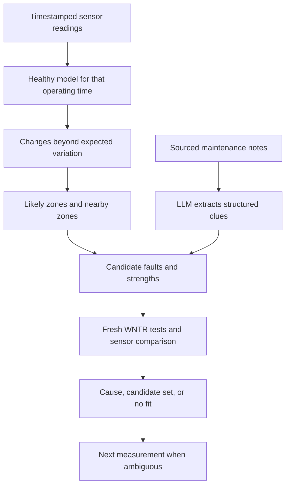

# WaterGuard — Project Working and Design Reference

**Status:** Current implementation audited against the user-supplied `waterguard 2(1).zip` on 23 October 2026. This archive, including its actual Python source and generated Net1 catalog, is the authority for the **Current** sections. Proposed version 3 reflects the design decisions discussed through 23 October 2026.  
**Purpose:** Explain what the system actually does today, what it will do in version 3, why each step exists, and what evidence is needed before making research claims.  
**Reading rule:** Sections marked **Current** describe the audited archive. Sections marked **Planned V3** are specifications, not features already delivered. If a newer local copy differs, inspect its code and update this document before citing exact counts or capabilities.

## 1. The idea in plain language

A water pipe network has pipes, junctions, pumps, storage and changing customer demand. A pressure or flow reading can change because of an ordinary operating condition or a fault. WaterGuard uses a hydraulic model to ask: *If this particular fault happened here, at this strength, what would the available sensors read?* It compares those predictions with observations and ranks explanations. If several explanations fit equally well, it should say so.

**Current:** Net1 synthetic readings or manually entered readings are compared against one saved healthy model snapshot. A precomputed catalog finds promising fault type/location pairs. Fresh WNTR simulations test those pairs. A FastAPI dashboard displays the evidence and advice.  
**Planned V3:** Compare with a healthy baseline appropriate to the observation time and known operating state; look for affected zones before detailed locations; refine candidate strengths; explicitly test distinguishability; suggest a useful next measurement; optionally use sourced maintenance history to prioritize *tests*, while keeping hydraulic evidence independent.

### The full proposed flow

The arrows from maintenance notes indicate **test priority**, not permission to invent sensor evidence. The current system only implements a subset of this flow, described next.

## 2. Current implementation: inputs and user experience

The browser serves `frontend/index.html`, `styles.css` and `app.js` through the same FastAPI server as the API. It has a Net1 schematic map, pressure and flow profiles across locations, manual sensor entry, sample scenarios, custom synthetic fault injection, investigation progress, a ranked report, and a JSON download. The main pressure and flow profiles have **location IDs on the horizontal axis**, not timestamps. A separate extended-period projection can illustrate a candidate over hours, but **diagnosis scores the initial snapshot only**.

- **Manual mode:** The user enters one or more junction pressures in metres, pipe flows in m³/s at the API boundary (the UI displays L/s), or both. Missing readings are omitted from the score. There is no live meter/SCADA feed or guaranteed sensor inventory.
- **Synthetic mode:** The user chooses one of three sample faults or a fault type, valid Net1 location and strength from 0.05 to 1.00. WNTR generates the apparent observations. Ground truth is returned to the browser for the demo reveal; the investigation request contains observed values, network name and budget, **not the chosen ground-truth fault**. This is a software separation within the demo, not a field validation study.
- **Network display:** Pipe ID `21` and junction ID `21` are different physical model elements. An observed change is at a *sensor*; it does not prove the fault is there. The map is a schematic, not a geographic map. **In this archive, ranked fault locations can be colored red/amber and the top candidate is placed in the headline even when the report says Ambiguous.** Such a highlight is a hypothesis, not a confirmed fault. See the audit notes in §14.

The web UI is wired to Net1. The backend permits WNTR's Net1 and Net2; Net2 investigation requires its own generated catalog. Net1 in this archive has nine junctions and twelve pipes. Reservoir, tank and pump appear on the topology but are not fault candidates in the three implemented families.

## 3. Current physics: what WNTR calculates

WNTR is the water network simulation library. For each candidate, the code loads a **fresh network model**, changes a physical parameter, and solves the resulting hydraulics. Predicted pressure at every original junction and flow through every original pipe are returned. The diagnostic run uses a single hour-zero hydraulic snapshot; parallel workers do not share a mutable model.

| Implemented fault family | Model change | Interpretation and limit |
| --- | --- | --- |
| `pipe_leak` | Split a pipe at a new midpoint node and add a leak with opening area `0.00035 × severity` m². | A pressure-dependent modeled opening; it is not an observed crack size. |
| `valve_closure` | Add minor loss to a selected pipe: `300 × severity / max(1.01 − severity, 0.01)`. | Models a restriction or partial closure; does not assert an actual controllable valve exists there. |
| `demand_surge` | Add `0.012 × severity` m³/s consumption at a selected junction. | An unexpected local demand increase relative to the modeled healthy condition. |

Severity is a **dimensionless model control from 0 to 1**, and its physical effect differs by fault family. It is not a universal percentage of damage. A surge of severity 0.19 adds 0.00228 m³/s (2.28 L/s) in this model. Model parameters are demo assumptions, not calibrated utility measurements.

The same hydraulic solver generates catalog signatures offline and verifies newly proposed severities online. The online verification is a **new simulation**, not a lookup or interpolation masquerading as one. A separate optional what-if simulation closes a leading pipe and assesses modeled pressure impact; it does not operate a real valve and assumes the pipe could be closed.

### 3.1 Why WNTR predicts pressures and flows

**WNTR is a physics-based hydraulic solver, not a machine-learning model trained on past leaks.** Net1 is an example *network description*; WNTR is the reusable simulation engine. Give the engine a different documented network and it can solve that network's hydraulics. The model supplies connections, lengths, diameters, roughness, elevations, sources, tank levels, pump/valve behavior and expected demands. WNTR predicts flow and pressure from those inputs, not from a table of answers to each fault. Its numerical output remains only as trustworthy as the model and operating inputs.

At each junction, **flow conservation** balances inflow with outflow, consumption and any leak. For each pipe, **energy conservation** links the difference in hydraulic head at its ends to resistance and flow. In SI units WNTR's simulator uses a Hazen–Williams pipe relation of the form

\[
h_L = 10.667\,C^{-1.852}d^{-4.871}L\,\operatorname{sgn}(Q)|Q|^{1.852},
\]

where `L` is pipe length, `d` is pipe diameter, `C` is the Hazen–Williams roughness coefficient and `Q` is signed pipe flow. Localized losses from restrictions also depend on flow. Pump curves, tank/reservoir head, valve settings and operating controls supply further constraints. Junction *pressure head* is hydraulic head minus elevation; pressure in pascals is approximately `ρg × pressure head`. All unknown junction heads and link flows affect one another, so WNTR solves the coupled nonlinear equations iteratively. `WNTRSimulator` uses Newton–Raphson with sparse linear solves; `EpanetSimulator` solves the EPANET equations with a Global Gradient Algorithm. WNTR also supports demand-driven and pressure-dependent demand modes; low-pressure fault studies should examine whether pressure-dependent demand is appropriate. These are **forward calculations**, not fault diagnoses.

For an opening, WNTR's leak model uses

\[
Q_{leak}=C_d A\sqrt{2gh}
\]

at its supported exponent 0.5: `A` is the supplied hole area in m², `C_d` the discharge coefficient, `h` the local *gauge pressure head* in metres, and `g` gravity. The default `C_d` is 0.75. The leak changes local pressure, which changes escaping flow and the rest of the network, so the simulator solves these quantities together. It can put a leak along a modeled pipe by splitting the pipe and adding a leak junction. An additional demand instead removes more water at a selected junction; a restriction adds head loss to a link. WNTR does not know which of these actually occurred until WaterGuard compares simulated *sensor predictions* with observations.

**Forward versus inverse:** Given fault family, location, physical parameter and operating state, WNTR returns predicted readings: `network + leak on P21 with A → pressures and flows`. Given readings alone, WaterGuard faces the inverse problem: propose and test possible families, locations and parameter values, score the predicted values at the *installed/measured* sensors, and report ambiguity. It cannot reliably infer an exact location if two faults have sensor effects smaller than noise and model error. For a candidate parameter `θ` (for example leak area), a practical objective is `loss(θ) = Σ_i w_i [observation_i − prediction_i(θ)]²`, with weights based on measured uncertainty rather than arbitrary scales. This is an inference/optimization design, **not a solver feature automatically provided by WNTR**.

### 3.2 What severity means in this implementation

WaterGuard defines the dimensionless `severity` and converts it into a simulator parameter using the three formulas in the table above. For example, a leak severity of 0.70 means `A = 0.00035 × 0.70 = 0.000245 m²`; it does **not** mean “70% of the pipe is broken.” At a *hypothetical fixed* pressure head of 20 m and `C_d = 0.75`, the orifice equation gives approximately 3.6 L/s; the actual simulated value may differ because opening the leak changes the pressure. A different mapping constant would change every result even with the same severity label.

WNTR accepts a continuous physical input such as an area of `0.0002345 m²` for severity 0.67 under the current mapping. The catalog's five strengths are merely **search starting points**. The current system interpolates to propose an in-between severity and runs a fresh WNTR verification; Planned V3 can optimize the *physical parameter continuously* over plausible bounds with repeated solves, count those solves against the budget and report an interval where sensor/model uncertainty prevents a precise estimate. The area coefficient, demand coefficient and restriction loss rule are **uncalibrated demo conventions**; translating a fitted severity into a real crack dimension or valve position requires calibration and a defensible fault model.

### 3.3 From Net1 to a physical hostel network

**Current:** Net1/Net2 are supplied example networks; there is no hostel-specific model, field sensors, field calibration or verified real-world localization. **Deployment path:**

1. Survey the real network and assemble a connectivity map with pipe lengths, diameters, materials/roughness and elevations; include tanks, reservoirs, pump curves, valves, control schedules, approximate demand patterns and actual sensor positions/units. Missing or wrong drawings must be measured or marked uncertain.
2. Build an EPANET `.inp` file or a WNTR `WaterNetworkModel` for those assets. Keep WNTR as the engine; replace Net1 with the hostel network input and update sensor-ID mapping and search configuration. It is unnecessary to write a new hydraulic solver for each hostel.
3. Calibrate **healthy** parameters against measured pressures, flows, tank levels and pump states across multiple ordinary operating periods. Validate on held-out times/sensors, record error and uncertainty, and use a time/state-matched baseline rather than the current hour-zero snapshot.
4. For an anomaly, make software copies of the calibrated model, insert hypothetical leaks/demand changes/restrictions, run WNTR, compare predictions only at available sensor locations and test whether the alternatives can be separated. The candidate faults are simulated on the computer; they are **not** deliberately created in the real hostel. Report a zone, competing causes, a next practical measurement or no adequate fit when warranted.

This establishes **feasibility of constructing a site-specific simulator**, not automatic accuracy on any arbitrary network. Without adequate topology, boundary/operating information and distinguishable sensor coverage, no hydraulic solver or LLM can guarantee correct fault location. A strong physical demonstration would construct a small pump/tank/pipe network, calibrate its normal readings, open a controlled outlet or partially restrict a valve, and compare held-out measurements with predictions. Those experimental results remain future evidence, not a current WaterGuard claim.

### 3.4 Trainable models: optional extensions, not current features

| Candidate | Input and training target | Appropriate use and limitation |
| --- | --- | --- |
| Calibrated hydraulic model | Fit uncertain demand, roughness, pump/valve parameters using *healthy field observations*. | First practical priority. Parameter calibration is optimization, not necessarily machine-learning training; validate on held-out periods. |
| Random forest or gradient-boosted trees | Sensor residuals and operating context → fault family/zone, trained on labeled synthetic scenarios plus any known field incidents. | Fast shortlist for one instrumented network; synthetic-only accuracy need not transfer to the field. |
| Neural surrogate | Network state + fault type/location/area → predicted sensor vector using many WNTR simulation runs. | Speeds up broad candidate search; recheck finalists with the physical solver and field data. |
| Graph neural network | Graph topology, asset attributes, operating state and sensor residuals → fault ranking or sensor predictions. | Investigate if training across different network layouts with enough varied examples; no justified claim of generalization from Net1 alone. |
| Learned residual correction | Physical prediction and operating state → systematic difference from *real* sensor readings. | Potentially correct model bias, but requires reliable measured data and checks for faults that the correction could hide. |

Synthetic WNTR runs can supply many *simulated* training examples without waiting for thousands of real leaks, but a learner trained on them inherits the assumptions and errors of the simulator. Separate scenarios, operating states and ideally networks for evaluation; obtain independent field or controlled physical data before claiming deployment accuracy. For the present project, **physics plus bounded continuous inverse search and honest distinguishability tests** is the recommended core; a trained model is optional acceleration or a measured improvement to evaluate against that baseline. The LLM's proposed history extraction in §9 cannot replace physics, calibration or sensor evidence.

## 4. Current mathematics: baseline, catalog and ranking

### 4.1 Healthy snapshot and signatures

`data/Net1_fingerprints.json` stores a healthy WNTR snapshot and candidate predictions. In this archive, `SEVERITIES = (0.05, 0.20, 0.35, 0.70, 1.0)` and catalog `SCHEMA = 3`. There are `(12 pipes × 2 pipe fault families + 9 junctions × 1 demand family) × 5 strengths = 165` candidate rows and one healthy offline simulation, **166 offline runs** total. The supplied catalog metadata reports WNTR 1.5.0, and all 165 rows have predictions. A row that fails during a future rebuild is recorded with an error and excluded from shortlisting.

The schema number is a **catalog compatibility marker**, not the product version. The loader rejects mismatched schema, network name or WNTR version. `start.command` rebuilds a missing or rejected Net1 catalog at startup. Changing the simulated fault logic or operating baseline may require an explicit new compatibility/versioning policy even if those three current checks still pass.

**Correction already present:** The low-strength grid, schema 3, rebuilt 165-signature catalog and a `demand_surge` at J21, severity 0.19 regression test are included in the attachment. This addresses the previously identified catalog gap. It establishes neither universal fault distinguishability nor the planned V3 zone search. The regression test itself cannot be claimed as passing until it is run in a compatible environment.

### 4.2 Which readings count

For the supplied pressure readings `P_obs` and flow readings `Q_obs`, the code computes a mean squared standardized mismatch against a prediction:

\[
S = \frac{1}{N}\left[\sum_{j\in J_{obs}}\left(\frac{P_j^{obs}-P_j^{pred}}{0.8\,\mathrm m}\right)^2 + \sum_{e\in E_{obs}}\left(\frac{Q_e^{obs}-Q_e^{pred}}{0.001\,\mathrm{m^3/s}}\right)^2\right],
\]

where `N` is the number of **supplied** readings. Lower is a closer fit. The denominator values are fixed demonstration scales (0.8 m and 1 L/s), **not measured sensor noise estimates**. Missing sensors contribute nothing. Negative pipe flow is possible because link flow has a stored direction.

First, the healthy catalog prediction receives a score. If that score is at most `0.02`, the graph reports no modeled anomaly and does not search faults. Otherwise, it compares the observations with each valid catalog row, retains the best sampled strength per fault family/location and shortlists up to the requested budget (eight in the UI).

For each shortlisted type/location, the estimator looks between neighboring catalog strengths. It projects the observed sensor vector onto the line between their simulated sensor vectors and clamps the interpolated strength within those two samples. **Interpolation proposes a strength; it does not verify it.** A fresh WNTR run at that proposed strength follows. Two verification runs execute per batch; the graph can stop after enough evidence or after its budget.

Successful candidates are sorted by the same sensor mismatch. Their displayed `relative_weight` comes from normalized `exp(−score/2)` values **among the tested candidates**. It is neither a calibrated probability nor proof that rank 1 is correct. The code in this archive flags ambiguity when there are fewer than two verified candidates, a poor best fit (`best ≥ healthy` or `best > 0.25`), or a small top-two score gap (`gap < max(0.02, best × 0.5)`). **It no longer has a mandatory “fewer than two sensors means ambiguous” condition.** These thresholds are demonstration heuristics. One reading may detect a change but generally cannot reliably locate its source; this current rule can still make an overconfident claim from sparse evidence.

The current `sensor_planner` offers a preliminary next-reading suggestion when ambiguous: among unmeasured **junction pressures**, find the biggest absolute predicted difference between the two best verified candidates. It does not yet account for measurement availability, noise, cost, more than two contenders or actual confirmation that the new reading separates them.

### 4.3 One complete current investigation

1. `frontend/app.js` requests Net1 topology and the saved baseline when the page loads. A preset/custom WNTR demo supplies a complete synthetic sensor vector; a manual entry supplies only the entered readings. The UI converts an entered flow in L/s to m³/s before posting.
2. FastAPI's Pydantic model requires at least one reading, validates Net1/Net2 and verifies each pressure ID is a junction and each flow ID is a pipe. The browser submits `{"network_name":"Net1","observed":{"pressures":{...},"flows":{...}},"budget":8}`.
3. `monitor` loads the catalog and scores the observed subset against the healthy hour-zero snapshot. `context` reads local SQLite rows independently; those rows do not change the baseline or shortlist.
4. `hypotheses` compares all 165 valid stored rows, keeps one sampled strength per fault type/location, sorts by fingerprint score and estimates a continuous strength for up to eight pairs. Its source comment still says 99, but the loop actually iterates over the catalog contents.
5. `simulate` tests two proposed scenarios at a time in separate fresh WNTR models. `evidence` ranks verified fits and checks its heuristic ambiguity rule. The graph may stop early after at least four online simulations when the next catalog competitor is sufficiently far behind; otherwise it continues until the budget or shortlist is exhausted.
6. `diagnose` provides up to five ranked explanations with all supplied sensor comparisons; `decisions.py` supplies advice, and for a distinct pipe diagnosis it may add a separate isolation what-if. `sensor_planner` may suggest a junction pressure for ambiguous cases. `report` includes scores, counts, recommendations, context and elapsed time.
7. For background sessions, the browser receives actual step events over SSE and then fetches the final report. It renders the map, alert, ranked hypotheses, evidence table, demo ground-truth reveal if applicable and JSON download. The synchronous API invokes the same graph without SSE.

This path runs regardless of whether OpenAI, AgentOps or LangSmith keys are supplied. The graph's node names describe orchestration, not separate LLM workers.

## 5. Current software connections

| Component/file | Responsibility and connection |
| --- | --- |
| `frontend/index.html` | Dashboard structure and controls. |
| `frontend/styles.css` | Dashboard styling and responsive layout. |
| `frontend/app.js` | Loads topology/baseline, posts demo and investigation requests, renders schematic and evidence, consumes server-sent events and fetches the completed report. |
| `backend/main.py` | FastAPI routes, Pydantic validation, Net1/Net2 selection, demo simulation, asynchronous in-memory sessions, event stream and static frontend hosting. |
| `backend/models.py` | Immutable candidate contract and catalog strength grid. |
| `backend/hydraulics.py` | WNTR network loading, fault injection, fresh snapshot and extended-period simulations, topology and pipe-isolation what-if. |
| `backend/fingerprints.py` | Offline catalog building/validation, signature shortlist and strength interpolation. |
| `backend/scoring.py` | Normalized sensor mismatch and grounded evidence text. |
| `backend/graph.py` | LangGraph state and nodes: monitor → context → hypotheses → simulation/evidence loop → diagnosis → sensor planner → report. |
| `backend/context.py`, `manage_context.py` | Local SQLite maintenance, demand-schedule and weather records; command-line record management. |
| `backend/decisions.py` | Deterministic operator advice. Planned maintenance at the selected restriction location can change advice wording. No physical action is triggered. |
| `backend/narrative.py` | Optional OpenAI LLM paraphrase of existing numeric evidence only. It cannot choose faults or change numeric scores in this version. |
| `backend/observability.py` | Optional AgentOps workflow/node instrumentation; configuration status for external tracing. LangSmith can trace the LangGraph execution when configured. |
| `data/Net1_fingerprints.json` | Generated healthy snapshot and fault signatures; never hand-author hydraulic numbers. |
| `evaluate.py`, `tests/` | Synthetic regression/evaluation cases and backend/frontend tests. |
| `requirements*.txt`, `.env`, `start.command` | Runtime and optional dependencies, local integration configuration and startup. The attachment contains a real `.env` file; its values are deliberately omitted from this document. This archive does not include `.env.example`. |

The user-facing path is `browser → FastAPI → LangGraph → catalog + SQLite + WNTR → report/events → browser`. `POST /api/investigations` starts a background investigation; `GET /api/investigations/{id}/events` streams its local progress; `GET /api/investigations/{id}` returns its result. `POST /api/investigate` is the synchronous alternative. Network, baseline, synthetic demos, time-series comparison and observability each have dedicated `/api/...` routes. The background session dictionary is process memory: a restart loses sessions, and it is not a production job queue.

| Current API route | Role |
| --- | --- |
| `GET /api/network/{name}` | Return WNTR topology and model IDs. |
| `GET /api/baseline/{name}` | Return catalog's single healthy snapshot and offline run count. |
| `GET /api/observability` | Report whether tracing is configured locally. |
| `GET /api/demo/{kind}` and `POST /api/demo/custom` | Generate synthetic observations; custom route also returns a time-series comparison. |
| `GET /api/demo/{kind}/series` and `POST /api/compare-series` | Return independent extended-period healthy/fault projections for display. |
| `POST /api/investigate` | Validate input and run graph synchronously. |
| `POST /api/investigations`, `GET /api/investigations/{id}`, `GET /api/investigations/{id}/events` | Create a session, retrieve its report and consume progress events. |

The stack is **Python, WNTR, LangGraph, FastAPI, Pydantic, Uvicorn, SQLite and plain HTML/CSS/JavaScript**. OpenAI, LangSmith and AgentOps packages are optional. No React or Node build is needed. LangGraph nodes are deterministic software stages; calling them “agents” does **not** mean each contains an LLM. LangSmith and AgentOps are tracing/observability services, not diagnostic engines. Local tracing remains available without API keys. A locally configured trace indicator is not proof that external delivery succeeded.

### Current history and LLM boundaries

The database currently has `maintenance(network, location_id, planned, note)`, `demand_schedule(network, junction_id, multiplier, note)` and `weather(network, condition, note)`. These rows **lack timestamps and source/reliability fields**. Demand-schedule and weather rows are reported as context but **do not change the healthy baseline or ranking**. Planned maintenance can alter recommendation wording for a matching restriction, but it does not change its score. The LLM, when explicitly enabled with `WATERGUARD_USE_LLM=1` and an OpenAI key, only attempts a short paraphrase after hydraulic evidence exists; failure falls back to deterministic text. The current application has no LLM-created fault hypotheses or history-derived ranking boost.

## 6. Planned V3: timestamp-aware healthy baseline (A)

**Meaning:** For an observation at time `t`, compute what a healthy network would produce under its **expected** demand pattern and known operating state at `t`. Compare the observed pressures/flows to those expectations, rather than to the same hour-zero snapshot at every time.

For example, if a morning reading at J21 is 80 m and the healthy morning simulation predicts 80 m, it is not a pressure anomaly merely because a fixed all-day reference predicts 75 m. Higher demand alone usually tends to reduce pressure; high pressure may also be normal if pump/tank/valve conditions explain it. The hydraulic model makes that joint prediction. Do **not** derive “normal” from the same current fault-contaminated observation being judged.

Specify readings as `{sensor_id, measurement_kind, value, unit, timestamp, quality}`. Specify a network model/version, expected time-of-day demand profiles, and known pump/valve/tank state (or explicitly mark unknown states). Simulate/cache the healthy state for that period, align timestamps and units, and score residuals. If reliable operating state or demand history is missing, report that uncertainty rather than pretending the baseline is exact. An unexpected localized demand surge is still a candidate fault **relative to expected demand**. Historical demand patterns and operating schedules used here are model inputs; unstructured maintenance notes belong to the LLM/history stage below.

This is a modest supporting change for the first V3 prototype: a small documented set of time slots and operating scenarios can demonstrate it. Continuous live SCADA and a complete utility demand forecast are outside the first build.

## 7. Planned V3: zone-first and neighbor search (B, the main extension)

Partition a **larger** water network into meaningful, possibly overlapping hydraulic zones. Do not assume “nearest on the picture” means hydraulically connected or most similar. Record each zone's pipes, junctions, boundaries, sensors and neighboring zones. Build coarse simulated change patterns for faults in each zone under comparable operating conditions.

1. Compare the observed change from the time-matched healthy baseline with coarse zone patterns at the **available sensors**.
2. Prioritize a small set of likely zones. Within them, select fault family, candidate pipe/junction and starting strength.
3. Run fresh WNTR simulations at detailed locations. Follow graph/hydraulic neighbors and expand to adjacent zones when fit is poor, the boundary is uncertain or the first budget is exhausted without an adequate explanation.
4. Keep a documented global reserve or fallback so a mistaken zone choice cannot permanently hide the true location. Log considered, skipped and tested candidates and the reason for each choice.

The benefit to test is **fewer online simulations and lower latency at comparable diagnosis quality**, especially on networks larger than nine junctions. On Net1, hierarchy might add complexity without demonstrating scale. V3's claim must compare equal budgets and report cases where an initially chosen zone was wrong.

## 8. Planned V3: strength search, uncertainty and next reading (C and D)

**Strength refinement:** A catalog or zone signature is a starting estimate. Convert severity to the *physical parameter* for that family (leak area, extra junction demand or restriction loss); run a bounded local search around promising values, with a fresh WNTR solve for each evaluated value. Count these against the online budget. Permit low-strength faults, valid range boundaries, failed simulations and an explicit **none of the modeled faults fits** result. Distinguish error in the fitted parameter from the arbitrary severity scale; do not infer real crack size or valve position from uncalibrated coefficients. Catalog interpolation alone is insufficient evidence for a final continuous estimate.

**Distinguishability:** Two faults can produce nearly identical readings at the installed sensors. Compare their *predicted sensor vectors*, taking account of estimated measurement noise and model error. A small raw score difference is not enough to assert an exact pipe. If predictions overlap at available sensors, report the smallest supported zone or a set of competing fault explanations, with uncertainty and the evidence that would help. Evaluate leakage versus demand surge and nearby locations explicitly. A result that accurately identifies its own ambiguity is useful.

**Next measurement:** Among readings that a technician or sensor can actually obtain, identify where the leading candidate set predicts meaningfully different outcomes. Consider more than two candidates, sensor noise, cost, access and expected reduction in ambiguity. After that reading is supplied, update the comparison and report whether it actually separates the causes. This is a planned extension of the current top-two junction-pressure heuristic, not a claim already achieved.

## 9. Planned V3: history and the LLM (E)

The LLM's defensible task is to **extract and propose testable, sourced clues** from messy maintenance/operating notes, not to calculate hydraulics. A structured event should retain its original text/source, timestamp, affected asset or area, activity, confidence/reliability and any ambiguity. Example: a verified recent corrosion note near P21 may make `pipe_leak at P21` worth testing sooner. A note about planned valve work may increase attention to a restriction scenario. Corrosion is not itself hydraulic proof and should never force a leak diagnosis.

**Order:** The model may process records before an alert. First derive an evidence-based zone/candidate shortlist from sensors and physics. Then use relevant records to make a **bounded, transparent priority adjustment** for the simulations to schedule. A strong record may add a testable candidate, but never silently veto sensor-supported candidates or remove an entire zone before testing. Reserve some budget for candidates with no supportive records and for expansion/fallback. Simulate proposed candidates with WNTR and score observed sensor fit independently of history. Show both fields separately in the report: `hydraulic evidence` and `historical context`.

A practical V3 selection rule can be: retain the best physics candidates regardless of records; allocate a limited number of remaining simulations to relevant record-suggested candidates; order close candidates using a capped context priority; fall back to neighboring/global candidates when fit is poor. The exact cap and budget allocation must be specified *before evaluation* and tested with accurate, absent, stale and misleading logs. Do not invent a numeric “LLM probability” or claim improved localization without an ablation against the no-history system.

**Naming:** We can honestly say “the LLM helps form and prioritize testable hypotheses from maintenance history.” Zone identification, continuous parameter search, physical prediction and measurement fit are algorithms plus WNTR. The current LLM only paraphrases evidence; the history role above is planned.

## 10. How the parts work together: example

1. At 09:00, installed sensors report pressure and flow. Use a normal 09:00 demand/operating scenario to predict healthy readings.
2. The difference is too large to explain as expected morning behavior. Several sensors suggest a zone near J21; other zones remain fallback candidates.
3. The zone search proposes, for example, a leak on P21 and a demand surge at J21. The severity optimizer runs multiple fresh WNTR tests within the budget.
4. A timestamped, sourced note says corrosion was reported near P21. The LLM extracts a possible leak clue; this moves a P21 test earlier or adds it to a reserved context slot. It does not change the measured pressure, the WNTR output or the sensor-fit score.
5. If both scenarios predict nearly the same values at installed sensors, report **“leak near P21 or demand change near J21; exact cause unresolved.”** Recommend an obtainable measurement where their predictions differ.
6. When that measurement arrives, repeat the comparison. Confirm a precise cause only if the sensor evidence and modeled uncertainty support it; otherwise retain the ambiguity or report no adequate fit.

This is an **illustrative V3 workflow**, not an assertion that current Net1 code performs these six steps.

## 11. Evaluation: evidence needed for the research claim (F)

Run held-out synthetic faults at strengths between catalog grid points, including small faults. Vary fault family/location, sensor count and placement, missing/bad readings, measurement noise, normal demand patterns, pump/tank/valve uncertainty and hydraulic model mismatch. Use Net1 to verify correctness and **at least one larger network** to assess zone-search scaling. Avoid selecting only easy fault locations. Keep scenario seeds, budgets and splits fixed across methods; prevent test scenarios from being used to tune thresholds without a separate evaluation split.

If adding a trained classifier or surrogate, evaluate it against a physics-only baseline on held-out fault locations, operating conditions and, when claiming portability, a held-out network. Never count simulations generated by the same uncalibrated model as independent field validation. A calibrated hostel or bench-scale physical network would be a separate deployment study: publish its network-input provenance, healthy calibration/validation errors, sensor locations, known test faults and uncertainty. Do not describe that study as completed until it exists.

| Comparison | What it isolates |
| --- | --- |
| Corrected V2 fixed catalog + WNTR | Baseline method and low-strength correctness. |
| V3 with zone search and the same simulation budget | Search efficiency and any accuracy tradeoff. |
| Add local strength optimization | Benefit and cost of extra continuous tests. |
| Add ambiguity/next-reading selection | Whether uncertainty is honest and one extra reading helps. |
| Add LLM/history priorities, then remove them | Incremental benefit and harm from real or misleading context. |

Report detection and false-alert rates; top-1/top-2 exact **type plus location** accuracy; zone accuracy; error in strength estimate; rate of abstention/ambiguity and accuracy among confident answers; pairwise indistinguishable cases; next-reading improvement versus a random/available alternative; WNTR run counts and latency; and failure cases. Separate offline catalog-generation cost from online diagnostic cost. Test some model mismatch because injection and inference with an identical perfect network produce optimistic results. The old ten-case Net1 synthetic evaluation is a regression/demo check, **not proof of field accuracy**.

The reviewer question is: *Can different faults actually be distinguished with the available sensors?* The answer must come from measured separation and error analysis. Where they cannot, the system should acknowledge the limit and seek another measurement rather than manufacture certainty.

## 12. Scope and delivery sequence

| Phase | Deliverable | Completion check |
| --- | --- | --- |
| 0 — correctness fix | **Present in supplied archive:** low-strength grid, schema bump, rebuilt Net1 catalog and J21 surge regression. | Run the regression test, fix outdated counts in tests/UI/guide, and restore honest sparse/poor-fit presentation. |
| 1 — evaluation foundation | Held-out scenarios, limited-sensor masks, metrics and budget accounting. | V2 reference results are reproducible. |
| 2 — main V3 feature | Time-matched baseline in a modest scenario set; zones, local search, neighbor expansion and fallback on a larger network. | Same-budget accuracy and WNTR count measured against V2. |
| 3 — research-critical reasoning | Better strength search, distinguishability, abstention and available next measurement. | Ambiguous pairs and gains after a real extra measurement are quantified. |
| 4 — optional history extension | Timestamped records, validated LLM extraction, capped scheduling priority and ablation. | Traceable sources and with/without-history results; misleading logs cannot force false confidence. |

Prioritize the **zone-first search (B)** as the signature V3 extension. A time-aware baseline (A) supports a valid comparison; C/D and rigorous evaluation turn the work into a credible diagnosis study. E is the constrained LLM contribution and can be added after the core hydraulic workflow. A live utility connection, automatic valve control and production deployment are not required to make the prototype/research study coherent.

## 13. Hardcoded assumptions and practical limitations

Some fixed values are appropriate *explicit demo parameters*, but must not be described as learned or field-calibrated: fault coefficients, **five** catalog strengths, sensor scaling (0.8 m and 1 L/s), anomaly threshold 0.02, poor-fit threshold 0.25, score-gap rule, default budget eight, two simulations per batch and Net1 sample scenarios. The frontend specifically uses Net1. The catalog, healthy baseline and most scenario observations come from the same solver/model. There is no operational sensor authentication, time-aligned field demand model, production persistence, calibration or guarantee that a suggested unmeasured junction can be sampled in reality. An unknown fault family can fit none of the three modeled classes.

`relative_weight` is conditional on candidates that happened to be tested, not an absolute confidence value. Maintenance context currently does not boost a rank; the future LLM must not be presented as doing so until implemented and evaluated. Do not claim that identifying a measured anomaly at J21 is equivalent to locating a fault at J21. Never treat tracing dashboards, simulated time-series plots or a visually prominent rank as independent hydraulic evidence.

## 14. Repo-specific audit findings and remaining work

These findings follow directly from the **attached archive**. They are part of its current state, even if a previously supplied `pro.zip` or the archive's `GUIDE.md` says otherwise.

| Observation | Exact effect | Files to reconcile |
| --- | --- | --- |
| Code and generated data use five strengths, schema 3 and 165 valid signatures; instructional text still describes three strengths, 99 signatures and 100 runs. | The dashboard and guide misdescribe the running search; the inline graph comment is stale. | `frontend/index.html`, `frontend/app.js`, `GUIDE.md`, `backend/graph.py` comment. Prefer deriving UI counts from API/catalog metadata. |
| Several tests still assert 99/100, `estimate >= 0.35`, or assume the first two stored strengths are 0.35 and 0.70. | The suite is inconsistent with this archive even though the new 0.19 J21 regression is present. | `tests/test_waterguard.py` should expect 165/166, use the grid's actual bounds and select rows by severity where a specific pair is required. |
| The older single-sensor pressure-rise regression was removed and the `sensor_count < 2` ambiguity gate was removed. | A single reading can receive a distinct best-match label if the score rules happen to permit it; sparse-sensor localization is not guarded independently. | `backend/graph.py`, `tests/test_waterguard.py`. Reinstate a defensible sparse-evidence rule or demonstrate calibration with limited sensors. |
| The map and report promote rank 1 even when `ambiguous` is true. `decisions.py` merges poor fit and close competitors into generic advice. | Visual prominence can suggest an exact cause that the report's ambiguity flag does not establish. A poor model fit is not distinguished from two good but overlapping hypotheses. | `frontend/app.js`, `backend/graph.py`, `backend/decisions.py`; add separate reason codes and tests. |
| The archive carries a populated `.env` and a copied `.venv`, and no `.env.example`. | These are machine-specific and may contain credentials or unsuitable binaries. | Packaging hygiene: distribute a redacted example config, exclude `.env` and `.venv`, and recreate the environment on each machine. Do not expose key values. |
| The catalog compatibility check covers schema, network name and WNTR package version, not a digest of the network/fault configuration. | A change in fault coefficients or model assumptions could leave a semantically stale catalog if the schema is not bumped. | `backend/fingerprints.py`, `backend/hydraulics.py`: record and validate a model/config fingerprint or explicitly bump the schema whenever behavior changes. |

These are **documentation and implementation gaps**, not evidence that the 0.19 correction is absent. The archive proves that the new data and regression test exist. The environment available for this documentation audit lacks WNTR, so full hydraulic/API tests were **not executed here**. The old `GUIDE.md` statement that all tests pass is not current verification of this uploaded ZIP.

## 15. Running and maintaining the audited version

From the extracted `waterguard 2` directory, run `bash start.command` and open `http://127.0.0.1:8000/`. The script selects a Python 3.11+ interpreter, creates/activates `.venv` if needed, installs core requirements, verifies/rebuilds the Net1 catalog if missing or stale under its current checks, then starts Uvicorn. An existing virtual environment must itself use Python 3.11+. For optional integrations, install `requirements-optional.txt` in that environment; configure the existing `.env` locally, restart and verify delivery in each service's dashboard. **The uploaded ZIP contains `.env` and an entire machine-specific `.venv`; do not publish it or circulate it with credentials.** Create a fresh virtual environment when moving to another machine. Never put keys in frontend code or commit `.env`.

The most reliable authority for **what is actually implemented** is the checked-out source and generated catalog. This document is the conceptual and architectural reference; update its Current sections, version/date and quantitative claims whenever code or data changes. Keep planned features labelled until implemented, tested and connected end to end.

## 16. Short presentation answer and hydraulic references

> “WNTR is a general hydraulic equation solver; Net1 is only our example network input. Conservation of flow, pipe head loss, pump and tank behavior, and a pressure-dependent leak equation produce predicted readings for each proposed fault. WaterGuard solves the reverse problem by comparing those predictions with measured sensors. For a hostel, we would map its actual network into EPANET/WNTR, calibrate healthy behavior against its sensors, and validate that model before fault diagnosis. The present project demonstrates the workflow on synthetic networks; a calibrated physical hostel and field localization accuracy are future validation work. If two faults look alike at the available sensors, the system must report ambiguity.”

Primary technical references: [WNTR water network models and EPANET imports](https://usepa.github.io/WNTR/waternetworkmodel.html); [WNTR hydraulic equations, leak model and solvers](https://usepa.github.io/WNTR/hydraulics.html); [WNTR simulator solver API](https://usepa.github.io/WNTR/apidoc/wntr.sim.core.WNTRSimulator.html); [EPA EPANET 2.2 user manual, including hydraulic analysis and calibration](https://nepis.epa.gov/Exe/ZyPURL.cgi?Dockey=P10113EM.txt). The constants and fault mappings specific to this project come from its audited `backend/hydraulics.py`, not from WNTR documentation.
